[Overview](index.html) · [Team Charter](team-charter.html) · [User Stories & Tasks](user-stories-and-tasks.html) · [Product Backlog](product-backlog.html) · [Sprint Backlog](sprint-backlog.html) · [Agile Logbook](logbook.html) · [Main portfolio](../)

---

# Sprint Backlog

*CareerCraft · Sprints 1 to 14*

The sprint backlog for each of our 14 sprints: the goal, tasks selected with owners, acceptance criteria, what was finished or still in progress, and the sprint walkthrough.

## Evidence

### Sprint 1: Project foundation and problem validation

*30 June–3 July 2026 · Evidence status: Reconstructed - team confirmation required*

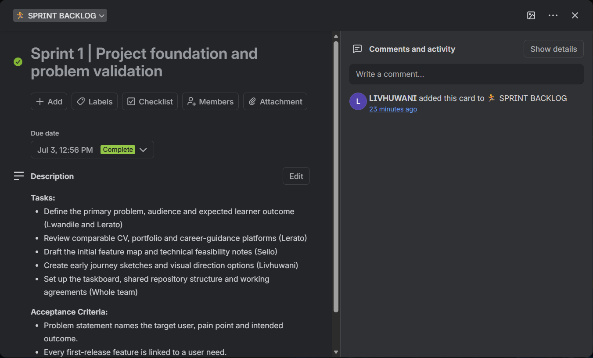

**Sprint goal:** Establish a shared understanding of the student career-readiness problem and define the first testable CareerCraft product direction.

**Selected tasks**

- Define the primary problem, audience and expected learner outcome (Lwandile and Lerato)
- Review comparable CV, portfolio and career-guidance platforms (Lerato)
- Draft the initial feature map and technical feasibility notes (Sello)
- Create early journey sketches and visual direction options (Livhuwani)
- Set up the taskboard, shared repository structure and working agreements (Whole team)

**Acceptance criteria**

- Problem statement names the target user, pain point and intended outcome.
- Every first-release feature is linked to a user need.
- Each backlog item has an owner and clear next action.

**In progress at sprint end**

- Review comparable CV, portfolio and career-guidance platforms
- Draft the initial feature map and technical feasibility notes

**Completed**

- Problem statement and target-user definition
- Initial feature map
- Team working agreement and prioritised discovery backlog

**Sprint walkthrough**

| Question | Answer |
|---|---|
| Is anyone working on anything that is not on the board? | Exploratory or support work must be added to the taskboard before it consumes material sprint capacity. |
| What do we need to finish as a team? | Team review of problem framing and first-release boundary. What worked: Shared ownership and a clear weekly goal kept work aligned. What should improve: Keep the first release focused on a reusable career profile, CV creation and clear user guidance. |
| Are there any bottlenecks or blockers to the flow of work? | Limited direct user evidence at project start; Risk of attempting too many career tools in the first release. |

### Sprint 2: Business model and pitch preparation

*7–10 July 2026 · Evidence status: Reconstructed - team confirmation required*

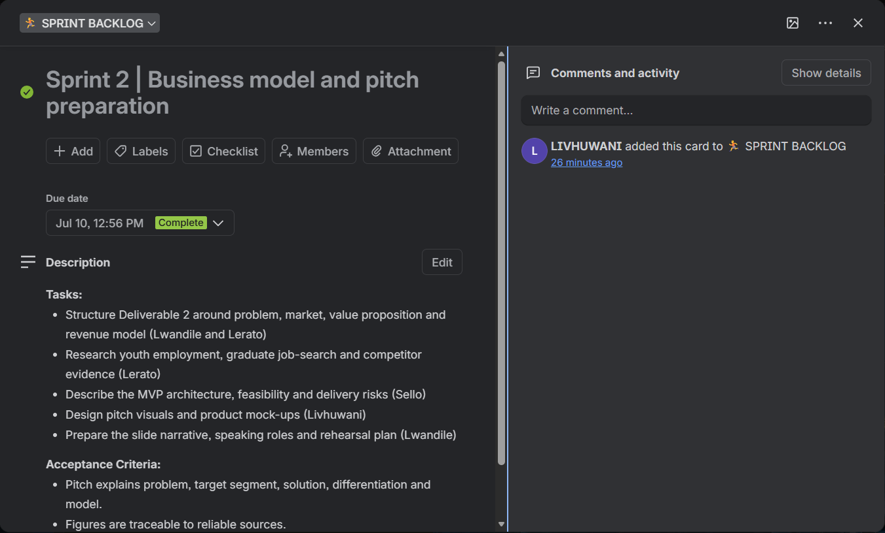

**Sprint goal:** Convert the validated concept into a defensible business and marketing proposition and prepare an investor-style presentation.

**Selected tasks**

- Structure Deliverable 2 around problem, market, value proposition and revenue model (Lwandile and Lerato)
- Research youth employment, graduate job-search and competitor evidence (Lerato)
- Describe the MVP architecture, feasibility and delivery risks (Sello)
- Design pitch visuals and product mock-ups (Livhuwani)
- Prepare the slide narrative, speaking roles and rehearsal plan (Lwandile)

**Acceptance criteria**

- Pitch explains problem, target segment, solution, differentiation and model.
- Figures are traceable to reliable sources.
- Speaking roles and timing are agreed before the panel session.

**In progress at sprint end**

- Research youth employment, graduate job-search and competitor evidence
- Describe the MVP architecture, feasibility and delivery risks

**Completed**

- Draft Business and Marketing Plan
- Draft investor-style pitch deck
- Market and competitor evidence notes
- Pitch rehearsal schedule

**Sprint walkthrough**

| Question | Answer |
|---|---|
| Is anyone working on anything that is not on the board? | Exploratory or support work must be added to the taskboard before it consumes material sprint capacity. |
| What do we need to finish as a team? | Internal rehearsal and completeness check against assessment requirements. What worked: Shared ownership and a clear weekly goal kept work aligned. What should improve: Use a clear evidence-first narrative and seek design guidance early when the team lacks a specialist skill. |
| Are there any bottlenecks or blockers to the flow of work? | Short preparation window; Design capability gap for a polished presentation; Market evidence quality varied across sources. |

### Sprint 3: Investor pitch and business-plan evidence

*14–17 July 2026 · Evidence status: Documented in the supplied logbook*

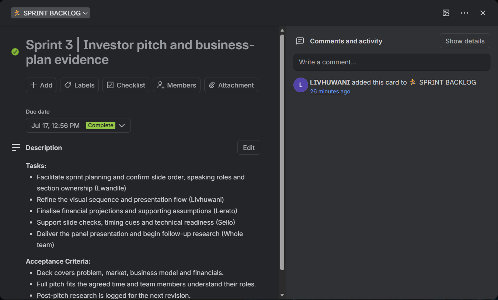

**Sprint goal:** Finalise and deliver the investor-style pitch, then strengthen Deliverable 2 with verified market and competitor evidence.

**Selected tasks**

- Facilitate sprint planning and confirm slide order, speaking roles and section ownership (Lwandile)
- Refine the visual sequence and presentation flow (Livhuwani)
- Finalise financial projections and supporting assumptions (Lerato)
- Support slide checks, timing cues and technical readiness (Sello)
- Deliver the panel presentation and begin follow-up research (Whole team)

**Acceptance criteria**

- Deck covers problem, market, business model and financials.
- Full pitch fits the agreed time and team members understand their roles.
- Post-pitch research is logged for the next revision.

**In progress at sprint end**

- Refine the visual sequence and presentation flow
- Finalise financial projections and supporting assumptions

**Completed**

- Final 16-slide pitch deck
- Deliverable 2 submission
- Investor-style pitch delivered on 15 July
- Research notes on market data and competitor platforms
- Pitch retrospective

**Sprint walkthrough**

| Question | Answer |
|---|---|
| Is anyone working on anything that is not on the board? | Exploratory or support work must be added to the taskboard before it consumes material sprint capacity. |
| What do we need to finish as a team? | Pitch delivered by Lwandile with the team supporting final checks and timing. What worked: Shared ownership and a clear weekly goal kept work aligned. What should improve: Campus IT facilities reduced connectivity risk; future evidence gathering should start earlier. |
| Are there any bottlenecks or blockers to the flow of work? | Limited rehearsal time because of overlapping academic commitments; Device and internet instability for the online presentation; Paywalled or outdated statistics; Official panel scoring was still pending. |

### Sprint 4: Backlog refinement and sprint readiness

*21–24 July 2026 · Evidence status: Documented in the supplied logbook*

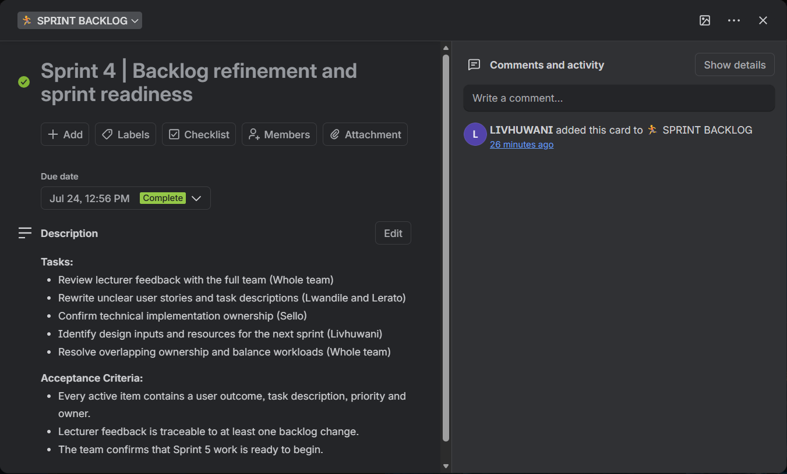

**Sprint goal:** Translate lecturer feedback into a prioritised, owned and implementation-ready Product Backlog.

**Selected tasks**

- Review lecturer feedback with the full team (Whole team)
- Rewrite unclear user stories and task descriptions (Lwandile and Lerato)
- Confirm technical implementation ownership (Sello)
- Identify design inputs and resources for the next sprint (Livhuwani)
- Resolve overlapping ownership and balance workloads (Whole team)

**Acceptance criteria**

- Every active item contains a user outcome, task description, priority and owner.
- Lecturer feedback is traceable to at least one backlog change.
- The team confirms that Sprint 5 work is ready to begin.

**In progress at sprint end**

- Rewrite unclear user stories and task descriptions
- Confirm technical implementation ownership

**Completed**

- Refined Product Backlog
- Updated priorities and statuses
- Assigned task ownership
- Implementation-ready design backlog

**Sprint walkthrough**

| Question | Answer |
|---|---|
| Is anyone working on anything that is not on the board? | Exploratory or support work must be added to the taskboard before it consumes material sprint capacity. |
| What do we need to finish as a team? | Backlog review confirmed that feedback had been addressed and ownership was understood. What worked: Shared ownership and a clear weekly goal kept work aligned. What should improve: Joint refinement improved clarity and prevented unclear responsibility from entering the design sprint. |
| Are there any bottlenecks or blockers to the flow of work? | Some recommendations required interpretation; Several tasks overlapped between roles and needed team discussion. |

### Sprint 5: User-interface prototype and accessibility redesign

*28–31 July 2026 · Evidence status: Documented in the supplied logbook*

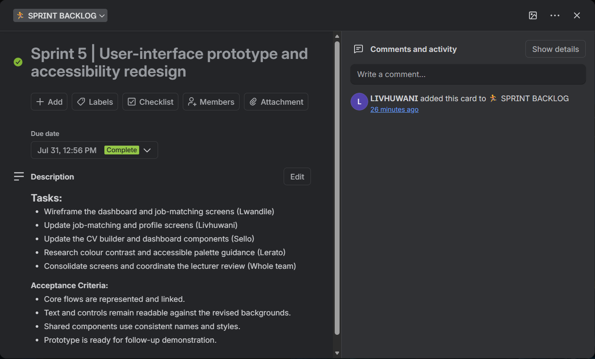

**Sprint goal:** Design the core CareerCraft experience in Figma, obtain lecturer feedback and revise the interface toward a brighter, accessible visual system.

**Selected tasks**

- Wireframe the dashboard and job-matching screens (Lwandile)
- Update job-matching and profile screens (Livhuwani)
- Update the CV builder and dashboard components (Sello)
- Research colour contrast and accessible palette guidance (Lerato)
- Consolidate screens and coordinate the lecturer review (Whole team)

**Acceptance criteria**

- Core flows are represented and linked.
- Text and controls remain readable against the revised backgrounds.
- Shared components use consistent names and styles.
- Prototype is ready for follow-up demonstration.

**In progress at sprint end**

- Update job-matching and profile screens
- Update the CV builder and dashboard components

**Completed**

- Low-fidelity wireframes for core screens
- Interactive Figma prototype
- Bright revised colour palette
- Colour-contrast reference guide
- Updated prototyping backlog

**Sprint walkthrough**

| Question | Answer |
|---|---|
| Is anyone working on anything that is not on the board? | Exploratory or support work must be added to the taskboard before it consumes material sprint capacity. |
| What do we need to finish as a team? | The lecturer identified the dark theme as too heavy; the team applied a brighter palette and completed an internal walkthrough. What worked: Shared ownership and a clear weekly goal kept work aligned. What should improve: Accessibility feedback must be addressed at design-system level, not as isolated screen corrections. |
| Are there any bottlenecks or blockers to the flow of work? | Original dark palette reduced readability; Shared Figma styles made colour changes sensitive; Follow-up lecturer availability was pending. |

### Sprint 6: Prototype showcase and brand improvements

*4–7 August 2026 · Evidence status: Documented in the supplied logbook*

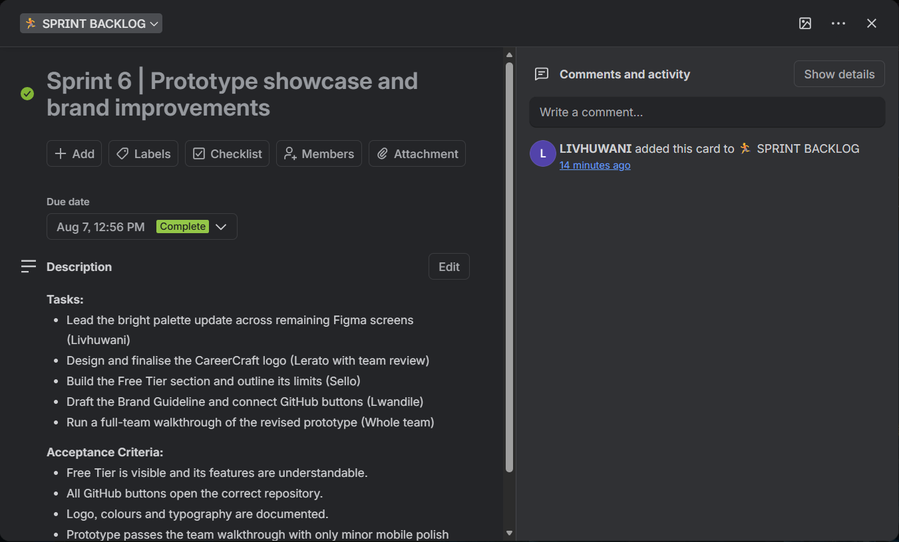

**Sprint goal:** Demonstrate the website prototype and implement the lecturer feedback on branding, pricing access, visual tone and functional links.

**Selected tasks**

- Lead the bright palette update across remaining Figma screens (Livhuwani)
- Design and finalise the CareerCraft logo (Lerato with team review)
- Build the Free Tier section and outline its limits (Sello)
- Draft the Brand Guideline and connect GitHub buttons (Lwandile)
- Run a full-team walkthrough of the revised prototype (Whole team)

**Acceptance criteria**

- Free Tier is visible and its features are understandable.
- All GitHub buttons open the correct repository.
- Logo, colours and typography are documented.
- Prototype passes the team walkthrough with only minor mobile polish remaining.

**In progress at sprint end**

- Design and finalise the CareerCraft logo
- Build the Free Tier section and outline its limits

**Completed**

- First class showcase of the website prototype
- Bright colour system applied
- CareerCraft logo
- Free Tier subscription option
- Brand Guideline
- Functional GitHub repository links

**Sprint walkthrough**

| Question | Answer |
|---|---|
| Is anyone working on anything that is not on the board? | Exploratory or support work must be added to the taskboard before it consumes material sprint capacity. |
| What do we need to finish as a team? | The updated prototype was demonstrated with the new visual identity, Free Tier and working links. What worked: Shared ownership and a clear weekly goal kept work aligned. What should improve: Lecturer feedback exposed trust and usability gaps beyond screen aesthetics; brand and access clarity became product requirements. |
| Are there any bottlenecks or blockers to the flow of work? | Reaching consensus on colours and Free Tier limits; Some links depended on final repository structure; Minor responsive issue in the mobile Free Tier section. |

### Sprint 7: Brand system and responsive design readiness

*11–14 August 2026 · Evidence status: Reconstructed - team confirmation required*

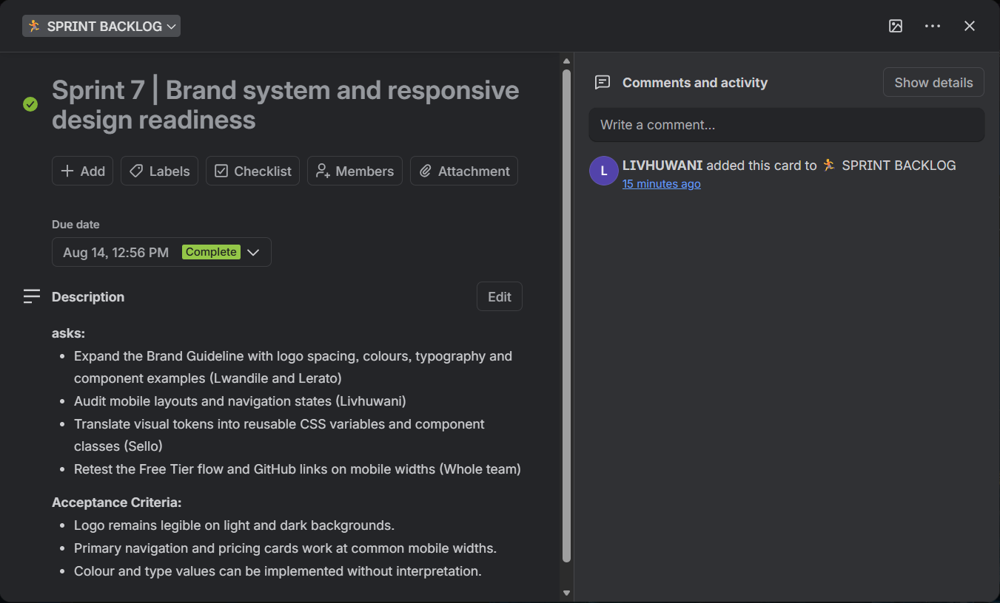

**Sprint goal:** Turn the approved visual direction into reusable implementation rules and close the remaining mobile and accessibility gaps.

**Selected tasks**

- Expand the Brand Guideline with logo spacing, colours, typography and component examples (Lwandile and Lerato)
- Audit mobile layouts and navigation states (Livhuwani)
- Translate visual tokens into reusable CSS variables and component classes (Sello)
- Retest the Free Tier flow and GitHub links on mobile widths (Whole team)

**Acceptance criteria**

- Logo remains legible on light and dark backgrounds.
- Primary navigation and pricing cards work at common mobile widths.
- Colour and type values can be implemented without interpretation.

**In progress at sprint end**

- Audit mobile layouts and navigation states
- Translate visual tokens into reusable CSS variables and component classes

**Completed**

- Implementation-ready brand guide
- Responsive-layout issue list
- Reusable style-token specification
- Mobile sign-up verification notes

**Sprint walkthrough**

| Question | Answer |
|---|---|
| Is anyone working on anything that is not on the board? | Exploratory or support work must be added to the taskboard before it consumes material sprint capacity. |
| What do we need to finish as a team? | Team demonstration of responsive states and reusable brand components. What worked: Shared ownership and a clear weekly goal kept work aligned. What should improve: A shared component system reduces future rework across a multi-page static application. |
| Are there any bottlenecks or blockers to the flow of work? | Design-to-code differences; Risk of inconsistent duplicated styles across separate HTML pages. |

### Sprint 8: Front-end foundation and navigation

*18–21 August 2026 · Evidence status: Reconstructed - team confirmation required*

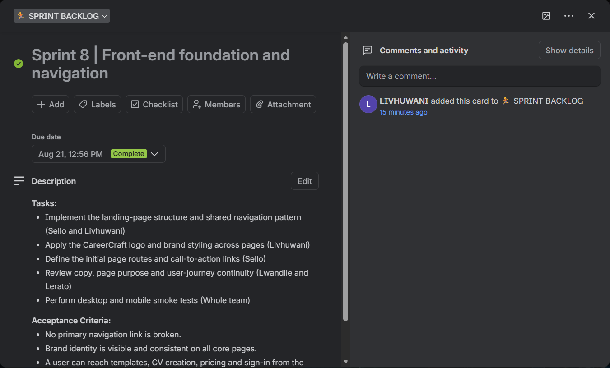

**Sprint goal:** Create the multi-page front-end foundation and make the core CareerCraft journeys reachable through consistent navigation.

**Selected tasks**

- Implement the landing-page structure and shared navigation pattern (Sello and Livhuwani)
- Apply the CareerCraft logo and brand styling across pages (Livhuwani)
- Define the initial page routes and call-to-action links (Sello)
- Review copy, page purpose and user-journey continuity (Lwandile and Lerato)
- Perform desktop and mobile smoke tests (Whole team)

**Acceptance criteria**

- No primary navigation link is broken.
- Brand identity is visible and consistent on all core pages.
- A user can reach templates, CV creation, pricing and sign-in from the landing page.

**In progress at sprint end**

- Apply the CareerCraft logo and brand styling across pages
- Define the initial page routes and call-to-action links

**Completed**

- Branded landing page
- Core HTML page set
- Consistent navigation and CTAs
- Responsive smoke-test checklist

**Sprint walkthrough**

| Question | Answer |
|---|---|
| Is anyone working on anything that is not on the board? | Exploratory or support work must be added to the taskboard before it consumes material sprint capacity. |
| What do we need to finish as a team? | End-to-end walkthrough from landing page to each core section. What worked: Shared ownership and a clear weekly goal kept work aligned. What should improve: Shared navigation and naming conventions should be treated as product infrastructure. |
| Are there any bottlenecks or blockers to the flow of work? | Duplicated navigation markup across pages; Risk of CTA destinations becoming inconsistent as features change. |

### Sprint 9: Authentication and career-profile foundation

*25–28 August 2026 · Evidence status: Reconstructed - team confirmation required*

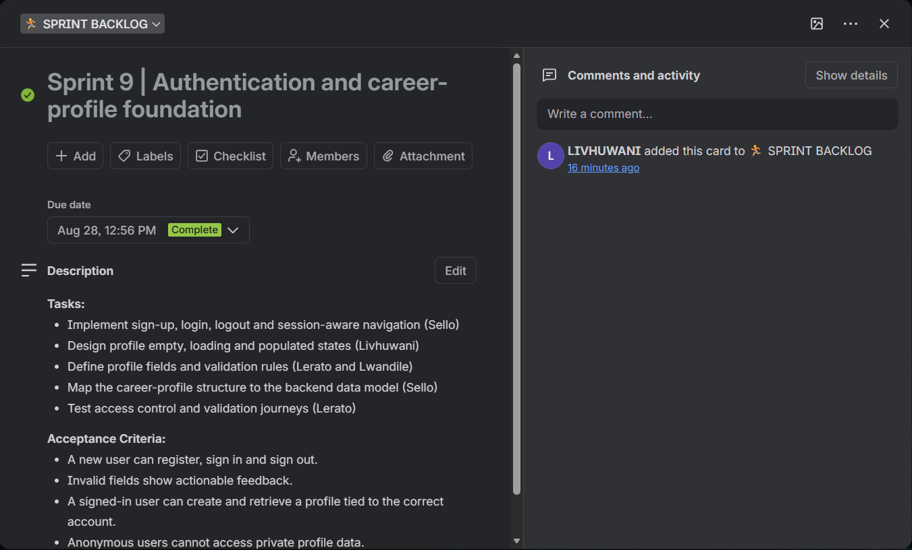

**Sprint goal:** Enable account creation and establish the user-owned career profile that will feed CVs, portfolios and AI tools.

**Selected tasks**

- Implement sign-up, login, logout and session-aware navigation (Sello)
- Design profile empty, loading and populated states (Livhuwani)
- Define profile fields and validation rules (Lerato and Lwandile)
- Map the career-profile structure to the backend data model (Sello)
- Test access control and validation journeys (Lerato)

**Acceptance criteria**

- A new user can register, sign in and sign out.
- Invalid fields show actionable feedback.
- A signed-in user can create and retrieve a profile tied to the correct account.
- Anonymous users cannot access private profile data.

**In progress at sprint end**

- Design profile empty, loading and populated states
- Define profile fields and validation rules

**Completed**

- Authentication flow
- Career-profile form
- Session-aware navigation
- Initial backend profile mapping
- Authentication test cases

**Sprint walkthrough**

| Question | Answer |
|---|---|
| Is anyone working on anything that is not on the board? | Exploratory or support work must be added to the taskboard before it consumes material sprint capacity. |
| What do we need to finish as a team? | Demonstrate registration, login, profile creation and a returning-user session. What worked: Shared ownership and a clear weekly goal kept work aligned. What should improve: Authentication and persistence must be tested together; a working form is not enough without correct user ownership. |
| Are there any bottlenecks or blockers to the flow of work? | Environment configuration across local and hosted contexts; Risk of exposing backend configuration incorrectly; Empty-state and session-expiry handling. |

### Sprint 10: Modular CV editor and template workflow

*1–4 September 2026 · Evidence status: Reconstructed - team confirmation required*

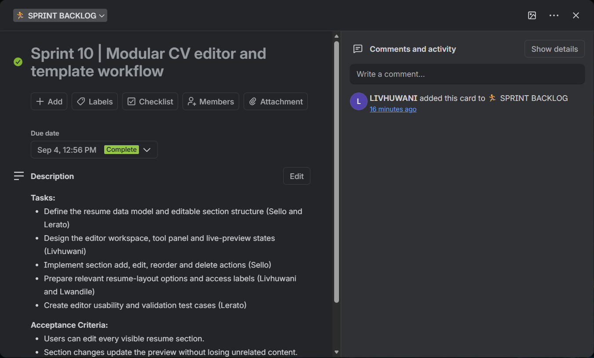

**Sprint goal:** Allow users to create or update a CV using modular sections and select an appropriate layout.

**Selected tasks**

- Define the resume data model and editable section structure (Sello and Lerato)
- Design the editor workspace, tool panel and live-preview states (Livhuwani)
- Implement section add, edit, reorder and delete actions (Sello)
- Prepare relevant resume-layout options and access labels (Livhuwani and Lwandile)
- Create editor usability and validation test cases (Lerato)

**Acceptance criteria**

- Users can edit every visible resume section.
- Section changes update the preview without losing unrelated content.
- At least two layouts are clearly available to Free users.
- The editor identifies missing required information before save or export.

**In progress at sprint end**

- Design the editor workspace, tool panel and live-preview states
- Implement section add, edit, reorder and delete actions

**Completed**

- My CV editor
- Modular resume sections
- Live preview
- Template selector
- Draft validation checklist

**Sprint walkthrough**

| Question | Answer |
|---|---|
| Is anyone working on anything that is not on the board? | Exploratory or support work must be added to the taskboard before it consumes material sprint capacity. |
| What do we need to finish as a team? | Demonstrate create-from-scratch, template selection and section editing. What worked: Shared ownership and a clear weekly goal kept work aligned. What should improve: Templates should render the same structured data rather than store separate copies of a CV. |
| Are there any bottlenecks or blockers to the flow of work? | Complex state synchronisation between form and preview; Potential mismatch between template design and stored resume data. |

### Sprint 11: CV persistence and profile retrieval

*7–11 September 2026 · Evidence status: Reconstructed - team confirmation required*

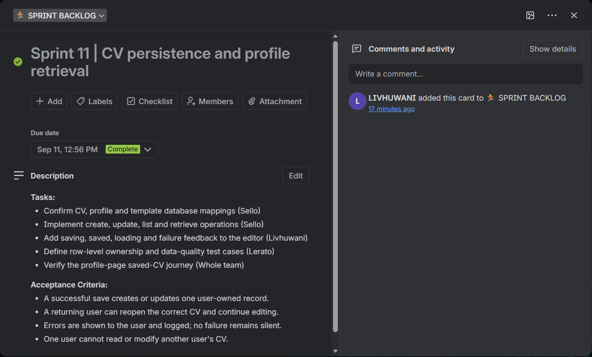

**Sprint goal:** Connect the CV editor to Supabase so authenticated users can save, retrieve and continue editing their documents.

**Selected tasks**

- Confirm CV, profile and template database mappings (Sello)
- Implement create, update, list and retrieve operations (Sello)
- Add saving, saved, loading and failure feedback to the editor (Livhuwani)
- Define row-level ownership and data-quality test cases (Lerato)
- Verify the profile-page saved-CV journey (Whole team)

**Acceptance criteria**

- A successful save creates or updates one user-owned record.
- A returning user can reopen the correct CV and continue editing.
- Errors are shown to the user and logged; no failure remains silent.
- One user cannot read or modify another user’s CV.

**In progress at sprint end**

- Implement create, update, list and retrieve operations
- Add saving, saved, loading and failure feedback to the editor

**Completed**

- CV persistence functions
- Saved-CV profile listing
- Resume ownership controls
- Visible save-state feedback
- Persistence test evidence

**Sprint walkthrough**

| Question | Answer |
|---|---|
| Is anyone working on anything that is not on the board? | Exploratory or support work must be added to the taskboard before it consumes material sprint capacity. |
| What do we need to finish as a team? | Test new CV save, existing CV update, logout/login retrieval and cross-user isolation. What worked: Shared ownership and a clear weekly goal kept work aligned. What should improve: Persistence acceptance criteria must include retrieval and ownership, not merely a successful insert response. |
| Are there any bottlenecks or blockers to the flow of work? | Schema-to-form mapping errors; Row-level security configuration; Silent failure risk if client errors are swallowed. |

### Sprint 12: LinkedIn AI tools and hosting stabilisation

*14–18 September 2026 · Evidence status: Reconstructed from September implementation evidence - team confirmation required*

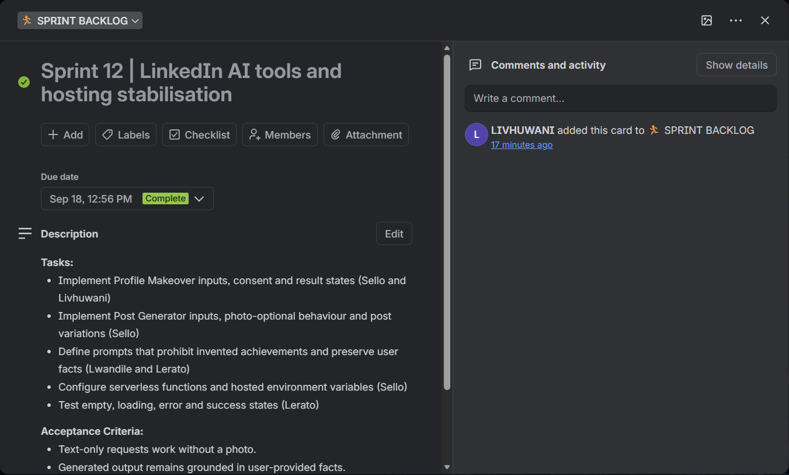

**Sprint goal:** Deliver usable LinkedIn Profile Makeover and Post Generator journeys while stabilising serverless deployment and environment configuration.

**Selected tasks**

- Implement Profile Makeover inputs, consent and result states (Sello and Livhuwani)
- Implement Post Generator inputs, photo-optional behaviour and post variations (Sello)
- Define prompts that prohibit invented achievements and preserve user facts (Lwandile and Lerato)
- Configure serverless functions and hosted environment variables (Sello)
- Test empty, loading, error and success states (Lerato)

**Acceptance criteria**

- Text-only requests work without a photo.
- Generated output remains grounded in user-provided facts.
- Every result has usable copy or edit actions.
- The browser receives valid JSON for both success and failure responses.

**In progress at sprint end**

- Implement Post Generator inputs, photo-optional behaviour and post variations
- Define prompts that prohibit invented achievements and preserve user facts

**Completed**

- LinkedIn Profile Makeover prototype
- LinkedIn Post Generator prototype
- Consent language
- Serverless AI endpoint
- Hosted configuration checklist

**Sprint walkthrough**

| Question | Answer |
|---|---|
| Is anyone working on anything that is not on the board? | Exploratory or support work must be added to the taskboard before it consumes material sprint capacity. |
| What do we need to finish as a team? | Demonstrate profile text analysis and a photo-optional post generation flow on the hosted site. What worked: Shared ownership and a clear weekly goal kept work aligned. What should improve: Error handling is part of the user experience; provider failures must be translated into actionable messages. |
| Are there any bottlenecks or blockers to the flow of work? | Provider quota and model compatibility; Missing or incorrectly scoped environment variables; Serverless routes returning HTML error pages instead of JSON; Image payload size. |

### Sprint 13: AI provider hardening and error recovery

*21–25 September 2026 · Evidence status: Reconstructed from September implementation evidence - team confirmation required*

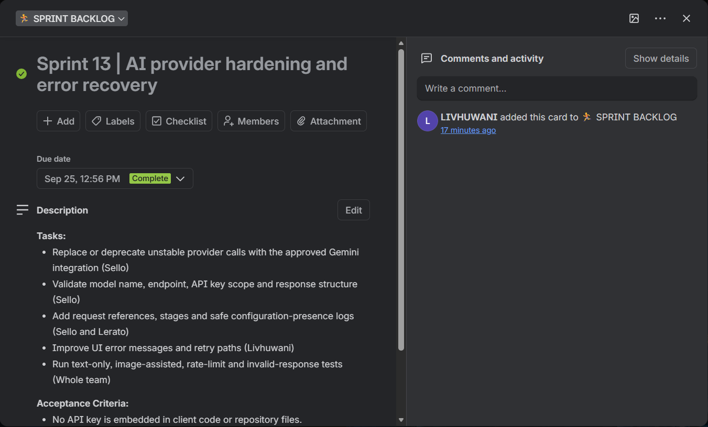

**Sprint goal:** Improve AI reliability by standardising the provider adapter, validating configuration and making failures diagnosable without exposing secrets.

**Selected tasks**

- Replace or deprecate unstable provider calls with the approved Gemini integration (Sello)
- Validate model name, endpoint, API key scope and response structure (Sello)
- Add request references, stages and safe configuration-presence logs (Sello and Lerato)
- Improve UI error messages and retry paths (Livhuwani)
- Run text-only, image-assisted, rate-limit and invalid-response tests (Whole team)

**Acceptance criteria**

- No API key is embedded in client code or repository files.
- Every function response uses JSON and an appropriate status code.
- Model errors identify a safe support reference.
- The interface recovers from retryable failures without losing user input.

**In progress at sprint end**

- Validate model name, endpoint, API key scope and response structure
- Add request references, stages and safe configuration-presence logs

**Completed**

- Gemini-backed AI adapter
- Provider response parser
- Structured function logs
- User-safe error messages
- AI regression test matrix

**Sprint walkthrough**

| Question | Answer |
|---|---|
| Is anyone working on anything that is not on the board? | Exploratory or support work must be added to the taskboard before it consumes material sprint capacity. |
| What do we need to finish as a team? | Verify generation on production configuration and review function logs against each negative test. What worked: Shared ownership and a clear weekly goal kept work aligned. What should improve: Configuration should fail fast with a precise stage; secrets and user content must never appear in public logs. |
| Are there any bottlenecks or blockers to the flow of work? | Model or endpoint mismatch; Secret scanning and deployment configuration; Rate limits and non-JSON upstream responses. |

### Sprint 14: Subscription entitlements and portfolio integration

*28–30 September 2026 · Evidence status: Reconstructed from September implementation evidence - team confirmation required*

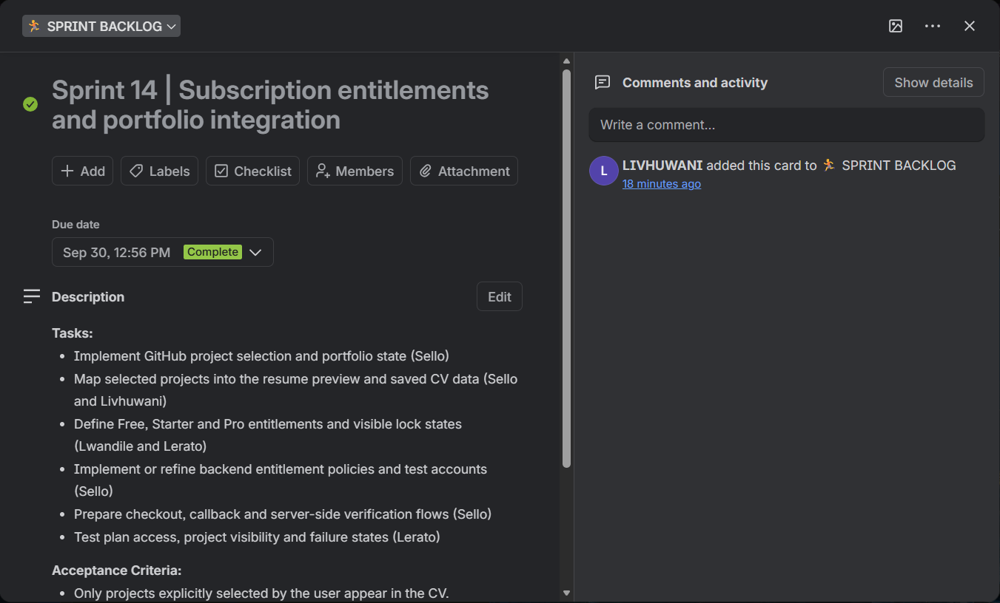

**Sprint goal:** Connect plan access to product tools, allow GitHub portfolio projects to appear in the selected CV and prepare the package-payment journey for controlled testing.

**Selected tasks**

- Implement GitHub project selection and portfolio state (Sello)
- Map selected projects into the resume preview and saved CV data (Sello and Livhuwani)
- Define Free, Starter and Pro entitlements and visible lock states (Lwandile and Lerato)
- Implement or refine backend entitlement policies and test accounts (Sello)
- Prepare checkout, callback and server-side verification flows (Sello)
- Test plan access, project visibility and failure states (Lerato)

**Acceptance criteria**

- Only projects explicitly selected by the user appear in the CV.
- Portfolio choices persist with the saved resume.
- Two resume designs remain available to Free users while premium designs and tools follow the entitlement matrix.
- Client-side payment success alone never activates a subscription.
- Test access can be granted through an auditable administrative process.

**In progress at sprint end**

- Map selected projects into the resume preview and saved CV data
- Define Free, Starter and Pro entitlements and visible lock states

**Completed**

- Portfolio project selector
- Selected projects rendered in the CV
- Plan entitlement matrix
- Locked-tool interface states
- Payment-ready checkout and verification design

**Sprint walkthrough**

| Question | Answer |
|---|---|
| Is anyone working on anything that is not on the board? | Exploratory or support work must be added to the taskboard before it consumes material sprint capacity. |
| What do we need to finish as a team? | Demonstrate project selection through resume preview, then verify plan-access scenarios for Free and Pro test users. What worked: Shared ownership and a clear weekly goal kept work aligned. What should improve: Entitlements require one authoritative backend rule set; interface locks are guidance, not security controls. |
| Are there any bottlenecks or blockers to the flow of work? | GitHub authentication and repository permissions; Mismatch between front-end locks and database policies; Payment callback security and duplicate-event handling. |

## Reflection

The sprint backlog made each week concrete. Because every task had an owner and every sprint had acceptance criteria, I could always see where my work fitted: wireframing the dashboard in Sprint 5, refining the visual sequence in Sprint 3, and then designing the editor workspace and live-preview states in Sprint 10. What I valued most was that the backlog was honest about unfinished work — the "In progress at sprint end" sections showed that delivery is rarely clean, and that carrying work forward is a normal part of sprinting rather than a failure.

The walkthrough questions produced lessons that carried forward across sprints:

- **Sprint 10** — templates should render the same structured data rather than store separate copies of a CV, which protected us from a whole class of consistency bugs.
- **Sprint 11** — persistence acceptance criteria must include retrieval and ownership, not just a successful insert.
- **Sprint 13** — configuration should fail fast with a precise stage, and secrets and user content must never appear in public logs.

Each of these started as a blocker and became a rule we applied in later sprints.

Recurring blockers also taught me that sprint plans have to allow for real constraints. Limited user evidence at the start, overlapping academic commitments, unstable connectivity and a design capability gap all affected what we could finish. The team's response — starting evidence gathering earlier, using campus IT facilities, and seeking design guidance early — showed me that acknowledging constraints in the plan is more useful than pretending they don't exist.

### One thing I would change

I would size sprint scope more deliberately to the team's actual capacity. Several sprints ended with two or three tasks still in progress, which suggests we consistently planned optimistically. I would also keep the *"is anyone working on anything that is not on the board?"* question honest by requiring unplanned work to be added to the taskboard **before** it consumes sprint capacity, rather than after — that single habit would make the backlog a truer record of where time actually went.
